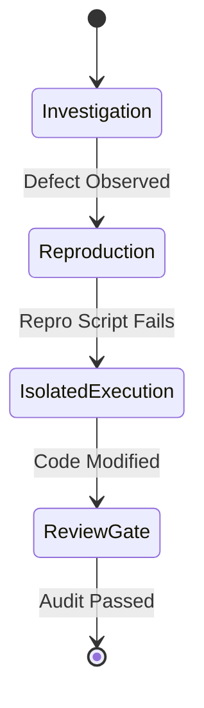

# Decision Trail: {{TASK_SLUG}}

> **Session ID:** `{{SESSION_ID}}`  
> **Start Time:** `{{START_TIME}}`  
> **Autonomous Grant:** `{{AUTONOMY_LEVEL}}`

---

## 1. Execution Timeline & State Machine

---

## 2. Decision Log (Auditable Record)

| Timestamp | Decision Fork | Choice Made | Evidence / Justification | Principles Cited |
| :--- | :--- | :--- | :--- | :--- |
{{DECISION_ROWS}}

---

## 3. Empirical Measurements & Verification Evidence
* **Baseline Metric:** `{{BASELINE_METRIC}}`
* **Final Metric:** `{{FINAL_METRIC}}`
* **Delta:** `{{DELTA_EXPLANATION}}`
* **Verification Proof:** `{{VERIFICATION_COMMAND_OUTPUT}}`
