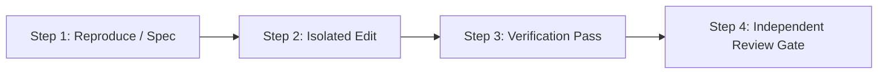

# Task Plan: {{TASK_NAME}}

> **Playbook:** `{{PLAYBOOK_NAME}}`  
> **Status:** `Awaiting Approval`  
> **Target Branch:** `{{TARGET_BRANCH}}`  
> **Model Tier:** `{{MODEL_TIER}}`

---

## 1. Objective & Non-Negotiables
{{OBJECTIVE_SUMMARY}}

* **Principles Invoked:** {{PRINCIPLES_LIST}}
* **Blast Radius Assessment:** {{BLAST_RADIUS}}

---

## 2. Canonical Domain Shape & Data Models
```typescript
{{DATA_MODEL_SPEC}}
```

---

## 3. Step-by-Step Verifiable Units



| Step | Unit / Operation | Worker | Verification Check | Status |
| :--- | :--- | :--- | :--- | :--- |
| **1** | {{STEP_1_TITLE}} | Coordinator | {{STEP_1_CHECK}} | Pending |
| **2** | {{STEP_2_TITLE}} | `poteto-agent` | {{STEP_2_CHECK}} | Pending |
| **3** | {{STEP_3_TITLE}} | `comment-sicko` | {{STEP_3_CHECK}} | Pending |
| **4** | {{STEP_4_TITLE}} | `thermo-nuclear-review` | Zero regressions pass | Pending |

---

## 4. Proceed Gate
> Click **Proceed** to authorize the coordinator to dispatch the worker subagent and execute this plan.
